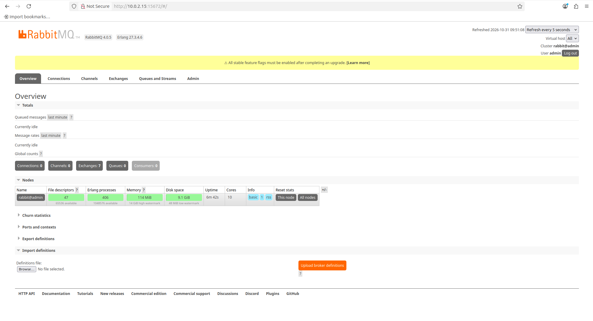
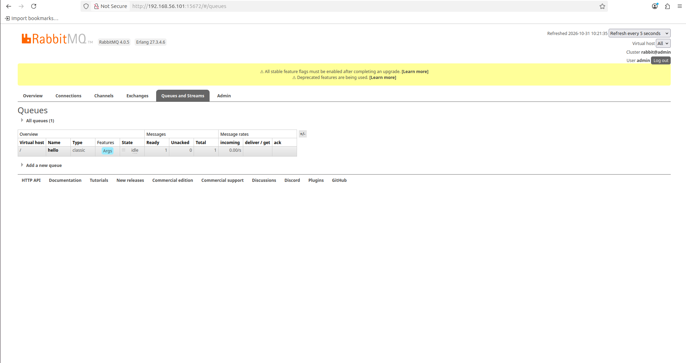
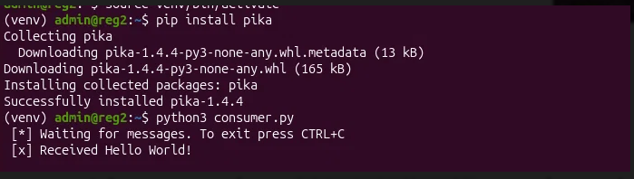
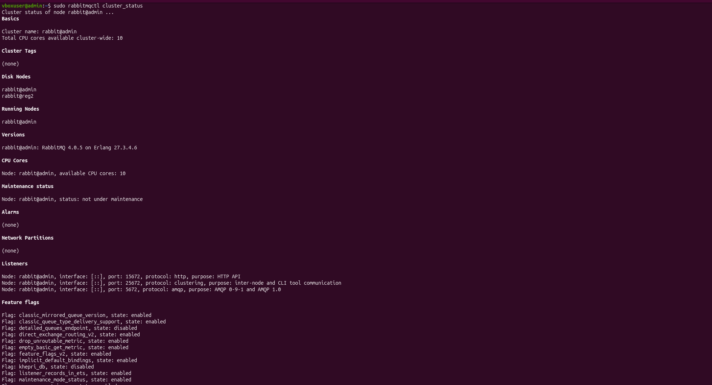
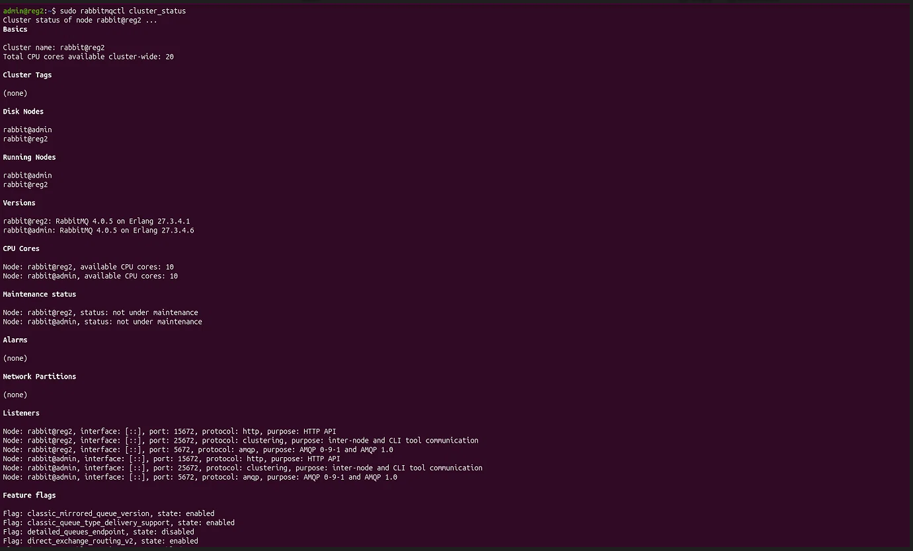
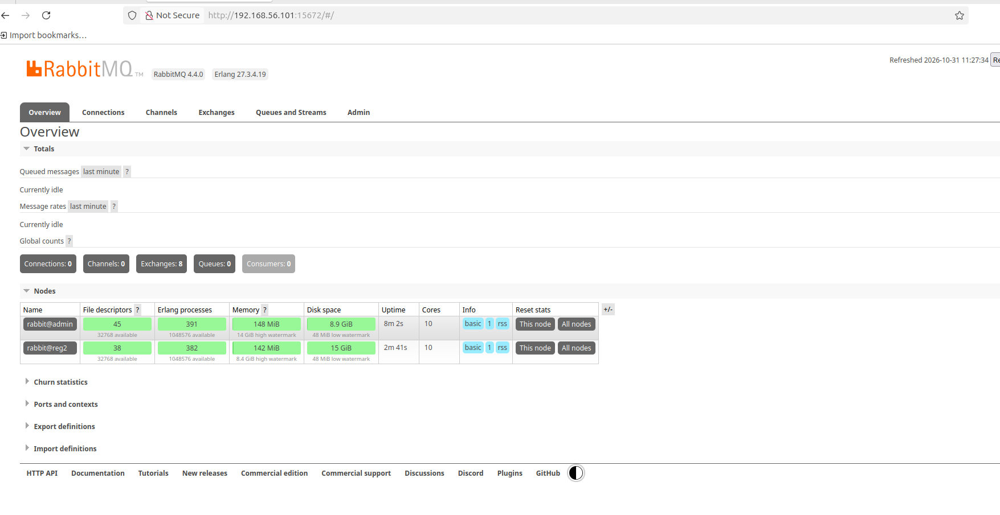
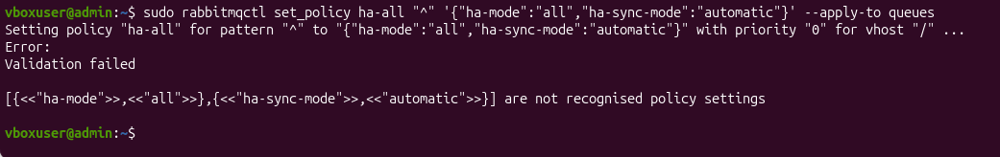

# Домашнее задание к занятию "`Очереди RabbitMQ`" - `Письменный Никита`

---

### Задание 1. Установка RabbitMQ

**Цель:** Установить RabbitMQ, включить management плагин и зайти в веб-интерфейс.

**Ход выполнения:**
1. Развёрнута виртуальная машина (VirtualBox) с ОС Ubuntu Server. Установлен пакет `rabbitmq-server`.
2. Включён плагин управления: `sudo rabbitmq-plugins enable rabbitmq_management`.
3. Создан пользователь `admin` с правами администратора для доступа к веб-интерфейсу.
4. Выполнен вход в веб-интерфейс и проверена главная страница управления.

**Скриншот 1. Веб-интерфейс RabbitMQ Management:**

---

### Задание 2. Отправка и получение сообщений

**Цель:** Используя скрипты `producer.py` и `consumer.py`, провести тестовую отправку и получение сообщения.

**Ход выполнения:**
1. Установлен Python 3 и библиотека `pika` на виртуальных машинах.
2. Настроены скрипты `producer.py` (отправка) и `consumer.py` (получение) с указанием IP-адреса сервера RabbitMQ и учётных данных.
3. Запущен `producer.py` — сообщение успешно отправлено. В веб-интерфейсе проверено наличие сообщения в очереди `hello`.
4. Запущен `consumer.py` на второй виртуальной машине — сообщение успешно получено.

**Скриншот 2. Очередь `hello` в веб-интерфейсе (1 сообщение Ready):**

**Скриншот 3. Вывод консоли `consumer.py` (успешное получение сообщения):**

---

### Задание 3. Подготовка HA кластера

**Цель:** Создать вторую виртуальную машину, объединить обе машины в кластер и настроить политику `ha-all`.

**Ход выполнения:**
1. Создана вторая виртуальная машина (reg2) и установлен RabbitMQ.
2. На обеих машинах в `/etc/hosts` добавлены записи для разрешения имён `admin` и `reg2`.
3. Erlang cookie синхронизирован между узлами (скопирован файл `/var/lib/rabbitmq/.erlang.cookie` с первой машины на вторую).
4. На второй машине выполнены команды для объединения в кластер: `rabbitmqctl stop_app`, `rabbitmqctl join_cluster rabbit@admin`, `rabbitmqctl start_app`.
5. Кластер успешно сформирован, что подтверждается выводом `rabbitmqctl cluster_status` с обеих нод и веб-интерфейсом.
6. **Примечание:** При попытке создать политику `ha-all` возникла ошибка `Validation failed: ... are not recognised policy settings`. В используемой версии RabbitMQ (4.0.x) классическое зеркалирование очередей (Classic Queue Mirroring) было полностью удалено. Параметры `ha-mode`, `ha-params` и `ha-sync-mode` больше не поддерживаются. Для обеспечения высокой доступности в RabbitMQ 4.x следует использовать кворумные очереди (Quorum Queues), однако создание политики `ha-all` было исключено из-за ограничений версии.

**Скриншот 4. Вывод `rabbitmqctl cluster_status` со второй ноды (reg2):**

**Скриншот 5. Вывод `rabbitmqctl cluster_status` с первой ноды (admin):**

**Скриншот 6. Веб-интерфейс: Overview → Nodes (два узла в кластере):**

**Скриншот 7. Ошибка при создании политики `ha-all` (ограничение RabbitMQ 4.x):**

